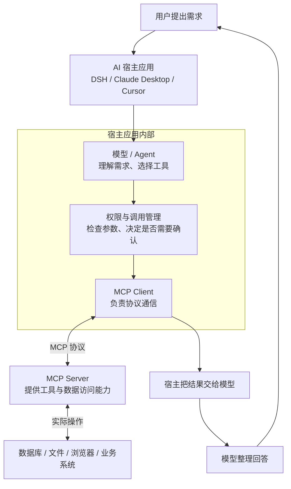
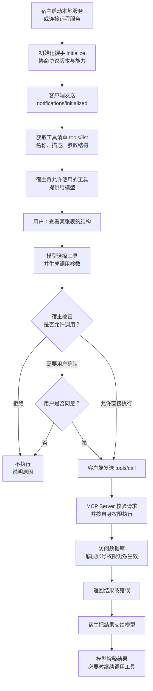
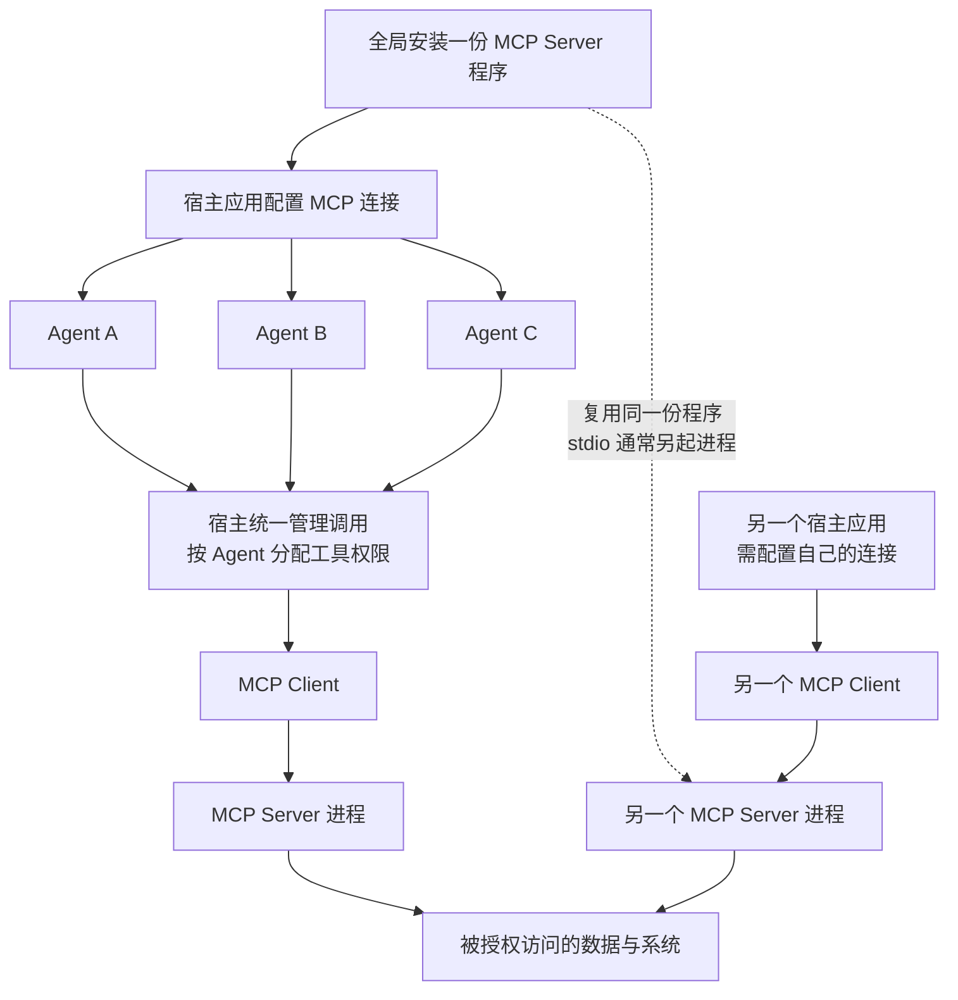

# MCP 机制与全局安装：架构、调用流程及 DBX 实例

> [!abstract] 来源与整理说明
> 本笔记根据本次对话整理，包含 MCP 机制介绍、三张 Mermaid 流程图，以及本机 DBX MCP Server 的安装检查结果。
> **总结模型：gpt-6.1-sol**；整理工具：DeepSeek Harness。
> 协议部分是概念说明，未在本次任务中逐项核对官方文档；本机环境部分以本次实际命令与初始化握手结果为依据。版本与路径是检查时的快照，不代表未来状态。

## 目录

- [[#一、MCP 是什么]]
- [[#二、核心角色与整体架构]]
  - [[#角色分工]]
  - [[#整体架构流程图]]
- [[#三、一次工具调用如何发生]]
  - [[#调用步骤]]
  - [[#工具调用流程图]]
- [[#四、MCP 提供哪些能力]]
- [[#五、本地与远程连接方式]]
  - [[#本地 stdio 模式]]
  - [[#远程 Streamable HTTP 模式]]
- [[#六、全局安装与多个 Agent 复用]]
  - [[#安装、配置、进程与权限是四个不同层级]]
  - [[#多 Agent 复用流程图]]
  - [[#npm 全局安装的边界]]
- [[#七、权限与安全边界]]
- [[#八、本机 DBX MCP 安装检查记录]]
  - [[#已验证的结果]]
  - [[#为什么会显示未安装]]
  - [[#本次未执行的操作与验证边界]]
  - [[#后续处理建议]]
- [[#九、常见误区与速记]]
- [[#十、相关笔记]]

## 一、MCP 是什么

**MCP（Model Context Protocol，模型上下文协议）是一套让 AI 应用连接外部工具和数据的标准协议。**

可以把它理解为 AI 的标准接口：

- **模型**负责理解问题、决定调用什么工具。
- **MCP**统一能力发现、参数传递、调用请求与结果返回。
- **工具程序**真正执行操作，例如读取文档、查询数据库、访问浏览器。

MCP 本身不是模型，不是某个具体工具，也不是把插件直接安装到模型里。它是宿主与外部服务之间的通信规则。

## 二、核心角色与整体架构

### 角色分工

| 角色 | 职责 |
|---|---|
| Host，宿主应用 | 管理对话、模型、权限和 MCP 连接，例如 DSH、Claude Desktop、Cursor |
| Client，客户端 | 在宿主内部负责与 MCP Server 进行协议通信 |
| Server，服务端 | 暴露工具和数据访问能力，执行具体操作 |

**Server 不一定是远程服务器，也可以只是本机上的一个进程。**

**Agent 不等于 MCP Client。** 多个 Agent 可以由宿主统一分配工具；是否每个 Agent 都有独立连接，取决于宿主实现。

### 整体架构流程图



此图侧重职责分工，不代表所有宿主的内部实现完全相同。

## 三、一次工具调用如何发生

### 调用步骤

以“查看数据库某张表的结构”为例：

1. **连接与初始化**：宿主启动本地 MCP Server 或连接远程服务，发送 `initialize`，协商协议版本与能力；成功后客户端发送 `notifications/initialized`。
2. **发现工具**：客户端通过 `tools/list` 获取名称、描述、输入参数结构等信息。
3. **提供工具给模型**：宿主筛选允许使用的工具，并将其描述提供给模型。
4. **模型提出调用**：模型根据需求选择工具并生成参数；工具调用并不是模型直接执行系统操作。
5. **检查权限**：宿主按策略决定允许、拒绝或要求用户确认。
6. **执行请求**：MCP Client 发送 `tools/call`，Server 校验请求，并按自身及底层系统权限执行。
7. **返回与解释**：宿主将结果或错误交给模型，模型组织回答，必要时继续调用工具。

示意工具调用：

```json
{
  "name": "get_table_schema",
  "arguments": {
    "connection_id": "example",
    "table": "orders"
  }
}
```

> [!note] 示例边界
> `get_table_schema` 是说明用的示意名称，不代表 DBX 的实际工具名称。MCP 请求通常采用 JSON-RPC 2.0；上面的片段仅展示工具名与参数，并非完整协议报文。

### 工具调用流程图



初始化和工具发现通常属于连接准备阶段，不必在每一次工具调用前重新执行。

## 四、MCP 提供哪些能力

| 能力 | 用途 | 示例 |
|---|---|---|
| Tools，工具 | 执行操作或按条件获取数据 | 查询数据库、搜索资料 |
| Resources，资源 | 提供可读取的上下文内容 | 文件、文档、系统信息 |
| Prompts，提示模板 | 提供可复用的任务模板 | 代码审查或分析流程 |

速记：**Tools 用来做事，Resources 用来读资料，Prompts 用来组织任务。**

服务不一定实现所有能力；能力如何展示、何时使用，仍由宿主应用决定。MCP 还存在其他可协商能力，这里只介绍最常见的三类服务端能力。

## 五、本地与远程连接方式

### 本地 stdio 模式

宿主启动 MCP Server 子进程，通过标准输入与标准输出交换协议消息。

- 不需要开放网络端口。
- 宿主负责启动和管理进程。
- 多个客户端可以使用同一份已安装程序。
- 不同客户端通常各自启动进程，不等于共用同一个进程。
- 标准输出需要用于协议消息；普通诊断日志通常应写到标准错误。

**本次检查的 DBX MCP 包声明了 stdio 传输。**

### 远程 Streamable HTTP 模式

客户端通过 HTTP 连接运行中的 MCP 服务，远程部署通常应使用 HTTPS。

- 多个客户端可以连接同一个服务地址。
- 服务可以集中部署、维护和升级。
- 需要处理认证、会话隔离、网络访问与权限。
- 服务必须支持对应传输方式；不能把仅支持 stdio 的程序直接当成 HTTP 服务。
- 同一个服务地址不代表所有客户端共享同一套会话或权限。

## 六、全局安装与多个 Agent 复用

### 安装、配置、进程与权限是四个不同层级

| 层级 | 共享的含义 | 是否自动随全局安装完成 |
|---|---|---|
| 安装层 | 多个客户端使用同一份 MCP Server 程序 | 是，全局安装主要解决这一层 |
| 配置层 | 保存启动命令、参数、地址与连接设置 | 否，取决于宿主和配置作用域 |
| 进程层 | 多个客户端连接同一个运行中的服务 | 否，stdio 通常各自启动；远程服务可集中运行 |
| 权限层 | 决定哪些 Agent 能使用哪些工具、访问哪些数据 | 否，需要宿主、Server 和底层系统共同限制 |

> [!important] 核心结论
> **不需要每个 Agent 安装一次 MCP Server。**
> 同一宿主中可以统一配置，再按角色分配工具；不同宿主通常仍需要各自配置连接。具体是否支持共享连接，由宿主实现决定。

### 多 Agent 复用流程图



这是常见的宿主组织方式示意，不是 MCP 协议强制规定的多 Agent 架构。

### npm 全局安装的边界

截图中的命令：

```bash
npm install -g @dbx-app/mcp-server@latest
```

`-g` 表示安装到当前 npm 配置的全局前缀中。默认通常与 Node.js 环境相关，也可以通过配置改变。

它不意味着所有 Node 版本、所有用户、所有桌面应用都会自动找到这个程序。尤其在 NVM 多版本环境中，经常出现：

- 程序已经安装在某个 Node 环境中。
- 另一个 npm 全局目录中却查不到。
- 从桌面启动的应用未加载终端的 NVM 初始化配置。
- 命令不在应用的 `PATH` 中，因此被误判为未安装。

诊断时可检查：

```bash
command -v node
node --version
command -v npm
npm --version
npm prefix -g
npm ls -g --depth=0 @dbx-app/mcp-server
```

这些命令只检查当前命令环境；当前目录查不到，不能直接断言所有环境都未安装。

## 七、权限与安全边界

有效权限可以理解为以下三层的交集：

1. **宿主权限**：哪些 Agent 可以调用哪些工具，哪些操作需要确认。
2. **MCP Server 权限**：允许哪些连接、数据范围与操作。
3. **底层账号权限**：数据库或业务账号实际能做什么。

数据库 MCP 的建议：

- 默认使用只读账号。
- 仅开放任务需要的连接。
- 写入、删除和结构变更等高风险操作要求明确确认。
- 保留调用审计记录，但避免在日志中暴露密码、令牌等认证信息。
- 将工具返回内容当成数据，不因其中出现“指令”就无条件执行。
- 对远程服务做好认证、网络隔离与会话隔离。

> [!warning] 协议不等于安全沙箱
> MCP 标准化连接与调用方式，但不会自动提供完整安全隔离，也不会保证模型的决策正确。权限策略和确认机制需要具体系统实现。

## 八、本机 DBX MCP 安装检查记录

### 已验证的结果

检查日期：**2026-10-14**。

| 检查项 | 实际结果 |
|---|---|
| NVM Node.js | `v24.19.0` |
| 同一 NVM 环境中的 npm | `11.17.0` |
| 已安装 DBX MCP Server | `@dbx-app/mcp-server@0.4.64` |
| NVM 默认版本 | `v24.19.0` |
| 本次查询 npm registry 的 latest | `0.4.118`，仅查询，未升级 |
| 标准 MCP 初始化 | 成功 |
| 握手返回服务信息 | `name: dbx`，`version: 0.4.64` |
| 握手协议版本 | `2024-11-05` |
| 握手返回能力 | `tools` |

已安装程序入口：

```text
/Users/ccy/.nvm/versions/node/v24.19.0/bin/dbx-mcp-server
```

包目录：

```text
/Users/ccy/.nvm/versions/node/v24.19.0/lib/node_modules/@dbx-app/mcp-server
```

显式使用这一环境检查安装的命令：

```bash
PATH="/Users/ccy/.nvm/versions/node/v24.19.0/bin:$PATH" \
  npm ls -g --depth=0 @dbx-app/mcp-server
```

### 为什么会显示未安装

当前 Agent 的默认环境混用了：

- 缓存运行时中的 Node.js `v24.19.0`。
- `/usr/local/bin/npm` 对应的旧 npm `6.14.13`。

默认 npm 查询的全局目录中没有 DBX MCP；随后检查其他 Node 环境，在 NVM 的 `v24.19.0` 中发现已安装版本。

因此，前面的“没有安装”初步结论已修正为：**已经安装，但当前默认命令环境没有找到它。**

截图中的 DBX 桌面应用显示 Node.js 未知、npm 不可用、未检测到全局安装。**环境识别问题是可能原因，但本次没有实际验证 DBX 桌面应用的检测调用链，不能写成已确认根因。**

### 本次未执行的操作与验证边界

- 没有重复安装。
- 没有升级现有软件包。
- 没有修改系统 PATH 或 DBX 配置。
- 没有修改数据库访问权限。
- 没有执行数据库查询或写入。
- 仅执行初始化握手；没有实际验证每个工具的可用性与数据库连接。
- 验证进程已退出，未保留额外 MCP 进程。

补充诊断：尝试 `dbx-mcp-server --version` 返回 `ConnectionClosed("initialize request")`，说明不能把这个参数当成已验证的版本查询方式。随后使用标准 MCP 初始化请求，成功得到服务版本与能力信息。

> [!success] 验证到哪一层
> 已证明程序安装存在，而且能启动并完成 MCP 通信。
> **尚未证明 DBX 桌面应用能够识别它、Agent 已完成连接配置、数据库权限可用或具体查询能成功。**

### 后续处理建议

1. 在 DBX 设置中点击“重新检查”。
2. 如仍未检测到，继续诊断 DBX 的 Node/npm 环境识别。
3. 客户端配置需要时，可考虑明确指定可执行文件与 Node 环境，避免依赖不确定的 PATH。
4. 是否升级至新版应单独决定；“已安装但未识别”不应优先通过重复安装解决。
5. 无需为每个 Agent 再安装一份 DBX MCP Server。

## 九、常见误区与速记

| 误区 | 正确理解 |
|---|---|
| MCP 是一个 AI 模型 | MCP 是通信协议 |
| Server 一定部署在远程机器 | Server 可以是本机子进程 |
| 每个 Agent 都要装一份 | 程序可复用，配置和工具分配由宿主决定 |
| 全局安装就自动连接所有 AI 应用 | 各宿主仍需配置并能找到程序 |
| stdio 客户端复用同一个安装就共用进程 | 通常各自启动进程 |
| 初始化成功就代表数据库操作已验证 | 初始化只证明协议通信，业务功能还需实际测试 |
| 连接 MCP 后就自动拥有全部权限 | 有效权限受宿主、Server、底层账号共同限制 |
| 当前 npm 查不到就肯定没安装 | 可能装在另一个 Node 环境中 |

**一句话总结：** MCP 是 AI 宿主与外部工具之间的标准通信协议：宿主连接服务并发现能力，模型选择工具，宿主检查权限，服务真正执行操作，再把结果交回模型。

**安装速记：** 程序安装一次，连接按宿主配置，进程按传输方式管理，权限独立控制。

## 十、相关笔记

- [[如何系统性的学习RAG、Agent、MCP - 程序员Sunday]]
